# Karaoke Dashboard

A small self-hosted web app for a home karaoke system built on
[UltraStar Deluxe](https://usdx.eu/). Guests browse the song library, report
songs that are broken and request new ones; contributors and admins review
those submissions, correct the songs' genres, export both for the song
pipeline, and keep the library itself tidy.

## Motivation

A home karaoke library grows to thousands of song folders on a NAS, and over
time some of them break: the timing is off, the lyrics are wrong, the audio
or video is missing. The people who notice are the singers, in the middle of
a karaoke night - and the same people know which songs they'd love to sing
next.

Collected in chat messages or on paper, that feedback gets lost or arrives
twice. Karaoke Dashboard gives it one place:

- **Guests** see what's in the library, which songs are already known to be
  broken and what was added recently.
- **Logged-in users** report a broken song or request a new one in a short
  form, and explore the library by genre.
- **Contributors** review each submission, complete it, and export the lists
  as CSV files that the song pipeline (UltraSinger batch processing and the
  USDX Song Factory) picks up to repair or create songs. They also correct
  genres, exported for the Factory to write into the song files.
- **Admins** can do all of that, and manage users, settings and the library
  checks: duplicates, files that break the UltraStar format, and folders
  that don't follow the `Artist - Title` convention.

## Features

### Song library

Search the library live, expand a song for its metadata (cover, length, duet,
genre, year, language). Songs with an open report carry a **Reported broken**
badge - until the report is resolved, or optionally until the song is fixed.

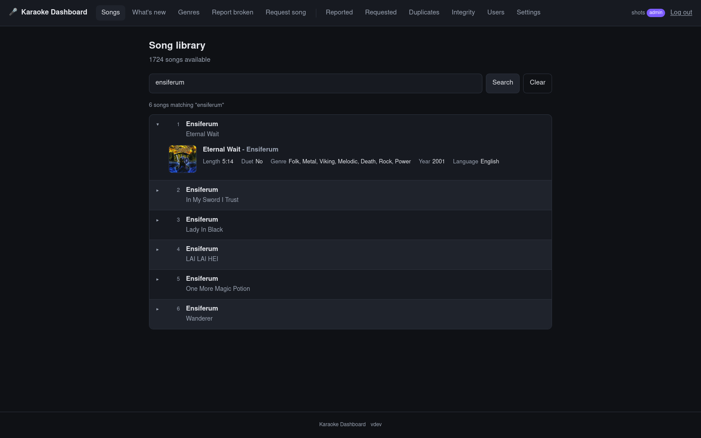

Every page works on a phone too:

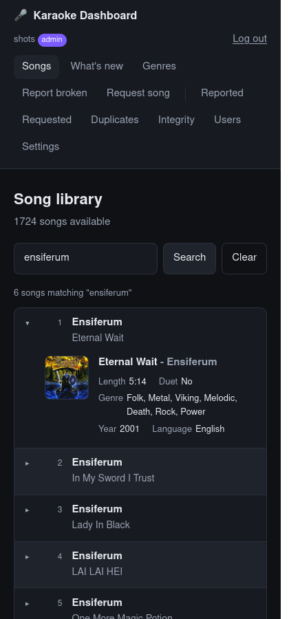

### What's new

**Recently added** and **Recently updated** side by side: the songs added to
the library and the songs whose files changed recently (2 months by default,
adjustable in days, weeks or months), with a search on top that narrows both.

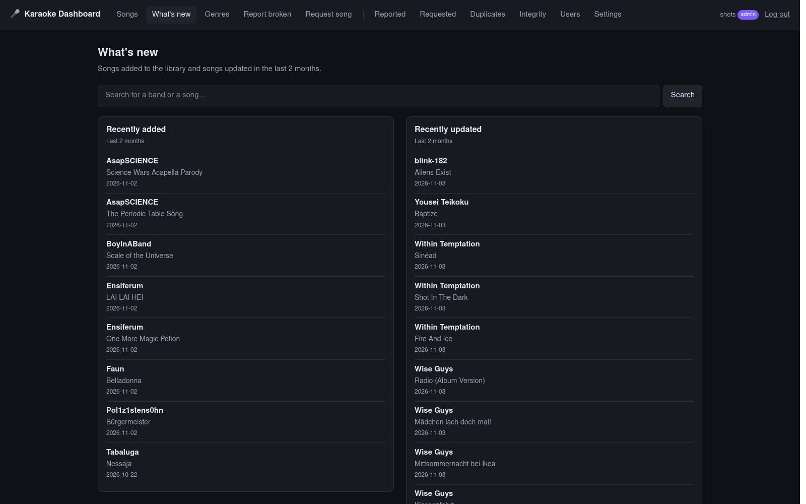

### Genres

The library by genre, read from the songs' `#GENRE` tags, for logged-in
users. **List** shows every genre with its song count and the songs of the
picked one; **Map** draws each song as a dot in the circle of its main genre,
related genres close together; **Connections** shows how genres share songs.

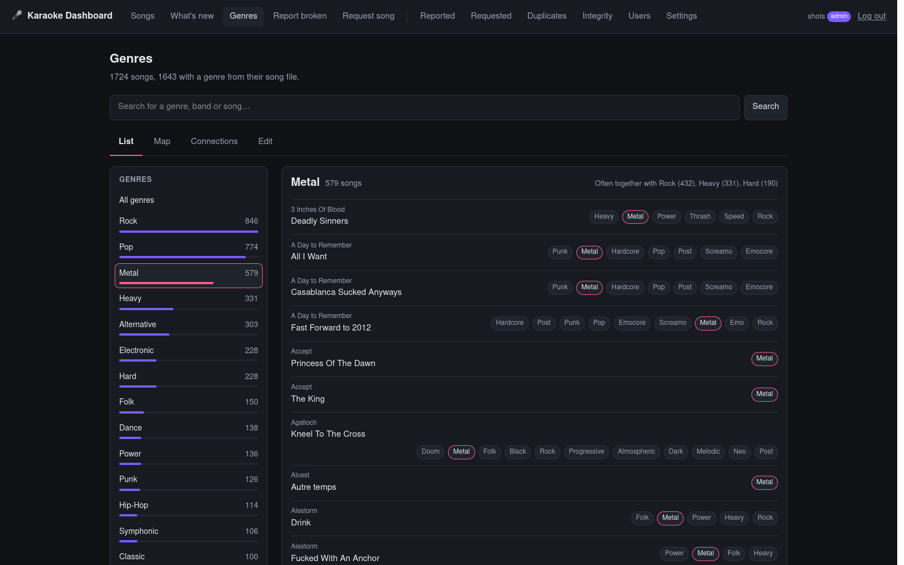
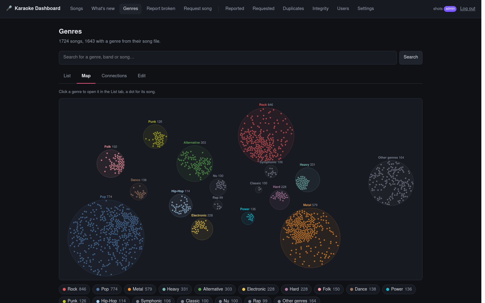
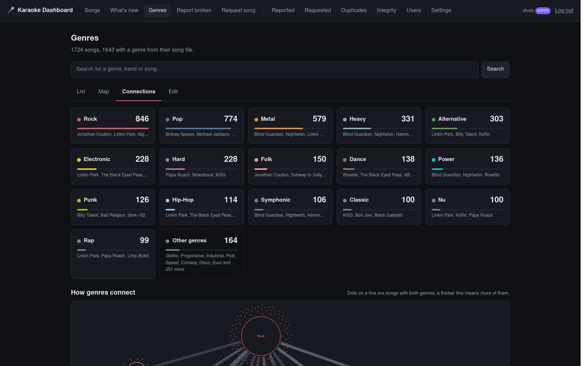

Contributors and admins get a fourth tab, **Edit**: change a song's genres
in place, and export every open edit as `genre-edits.tsv` for the USDX Song
Factory, which writes them into the song files. An edit shows everywhere at
once and ends by itself once the library scan reads the new genres.

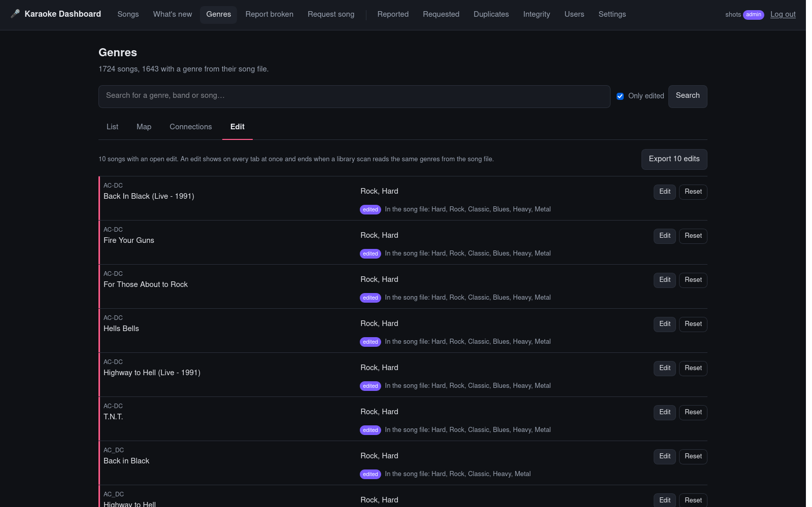

### Report a broken song / request a song

Short forms for logged-in users. A report names the song, a category (gap,
out of sync, lyrics, video, audio, cover, other) and what's wrong; a request
names band and title plus optional links. Duplicates are merged or refused,
so a song never shows up twice.

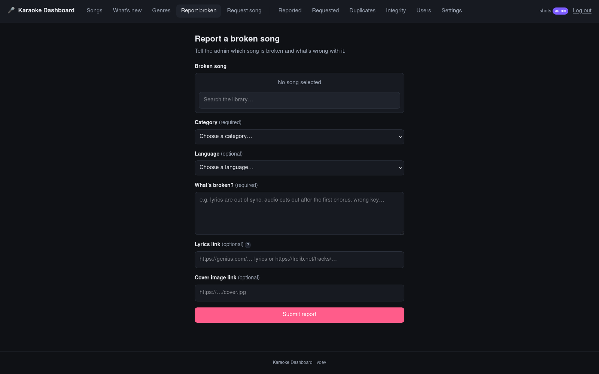
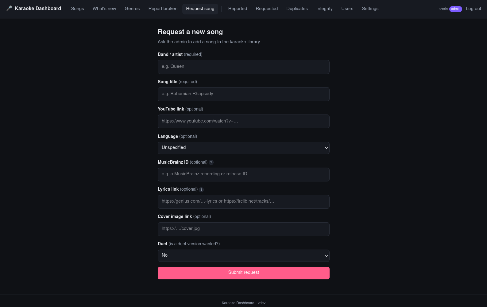

### Review and export (contributors and admins)

New reports and requests wait in **Needs review**. A contributor completes them -
including genre and vocal/instrument tags - and admits them into the
exportable list, which downloads as CSV. Existing CSV files can be imported
back, merging with what's already there.

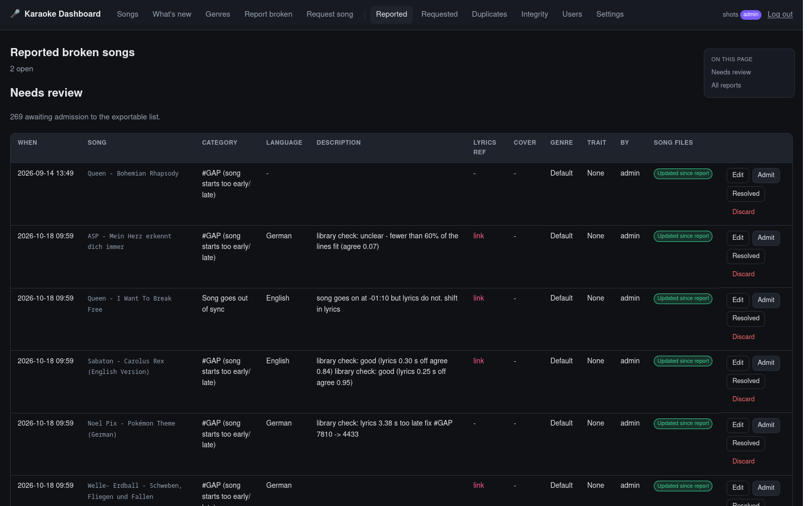
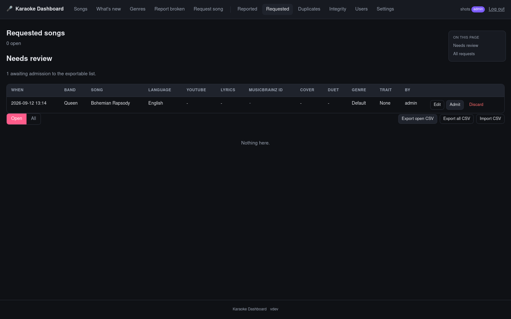

### Library checks

**Duplicates** (contributors and admins) finds songs that exist more than
once, possible duplicate versions and folders without a song file.
**Integrity** (admins) checks every song file against the UltraStar format,
flags folders that break the `Artist - Title` convention and songs sitting in
the wrong folder, and exports playlists and move lists to fix them.

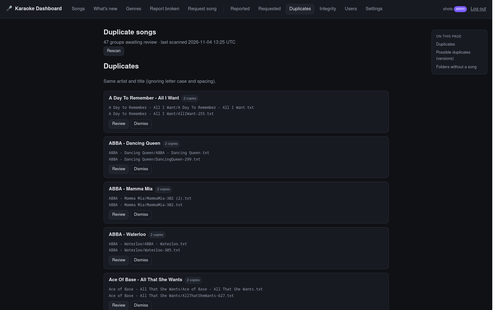
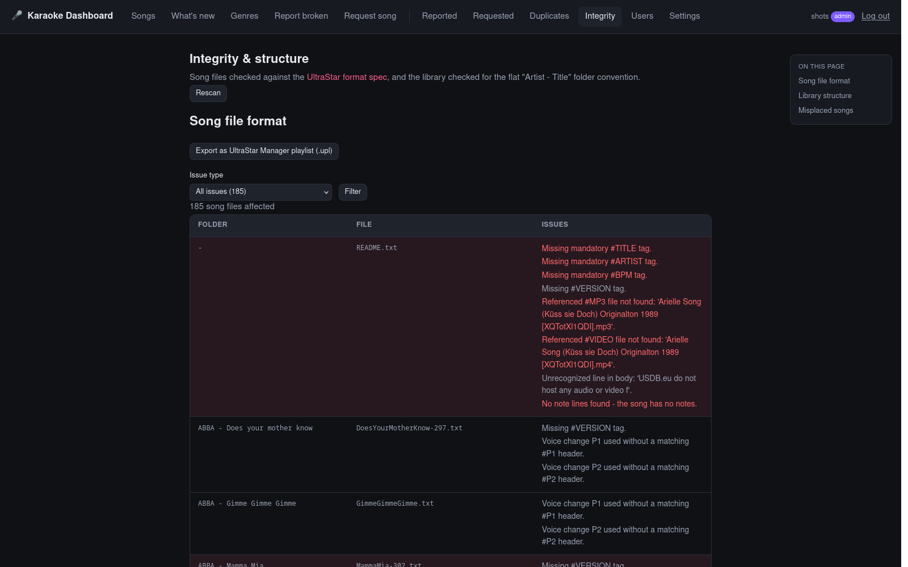

### Library scripts

The dashboard never changes a song file. Three standalone scripts in
`scripts/` do, run by hand against the songs directory (not part of the
image). Each has a `--dry-run` mode:

| Script | What it does |
| --- | --- |
| `fix_case_mismatches.py` | Renames files whose name differs from their `.txt` tag only in letter case - a rename an SMB share refuses. |
| `repair_library.py` | Links missing audio/video sources, moves duets that need re-timing into their own folder, and writes what it can't fix as a CSV to import on the Reported tab. |
| `apply_moves.sh` | Applies a move list exported from the Integrity tab, moving misplaced files into the right folders without overwriting anything. |

```bash
scripts/fix_case_mismatches.py --dry-run --root /volume1/music/karaoke
scripts/repair_library.py --dry-run --root /volume1/music/karaoke --csv repairs.csv
scripts/apply_moves.sh --dry-run --root /volume1/music/karaoke non-conforming.moves misplaced.moves
```

Details, and the order to run them in, are in
[docs/library-scripts.md](docs/library-scripts.md).

### Users and settings (admins)

Accounts are created by an admin; there's no self-registration. A user is a
plain **user**, a **contributor** (Reported, Requested, Duplicates and genre
editing) or an **admin** (everything). Settings switch each public form
between a relaxed **karaoke night** profile and a **strict** one, the app
between production and debug mode, and set how long the "Reported broken"
badge stays, when the library scan runs, the What's new period and how many
genres the map shows.

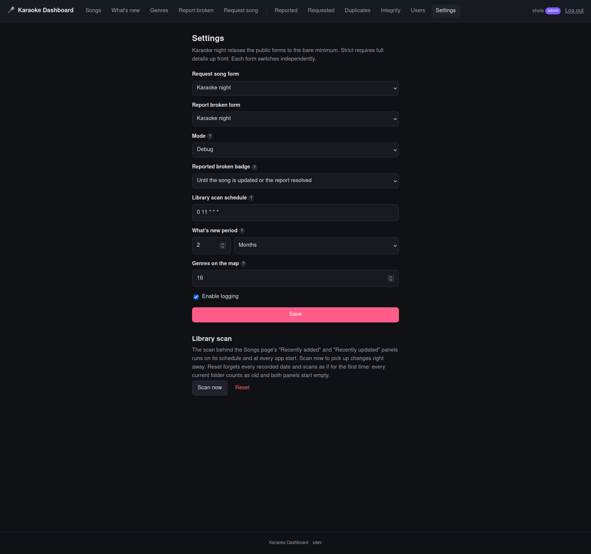

## Quick start

### Deploy on a Synology NAS

You need Container Manager (or Portainer) and your karaoke library on the NAS.

1. Create the folder `/volume1/docker/karaoke-dashboard/db`.
2. Copy [`.env.example`](.env.example) to
   `/volume1/docker/karaoke-dashboard/.env` and fill it in:

   ```bash
   openssl rand -hex 32   # SECRET_KEY
   openssl rand -hex 24   # POSTGRES_PASSWORD
   ```

   Set `ADMIN_PASSWORD` too - the `admin` account is created on first start.
3. Copy [`docker-compose.yml`](docker-compose.yml) next to it and point the
   songs mount at your library:

   ```yaml
       volumes:
         - /volume1/music/karaoke:/songs:ro
   ```

4. **Container Manager -> Project -> Create** from that folder and start it.
5. Add a **reverse proxy** (Control Panel -> Login Portal -> Advanced ->
   Reverse Proxy) from your hostname to `127.0.0.1:9713`, and open the app
   through that hostname. The port only listens on the NAS itself, by design.

Update to the newest build with:

```bash
docker compose pull && docker compose up -d
```

The database schema is created and updated automatically. Pinning a version,
the reasoning behind the port binding, troubleshooting and every setting are
in [docs/deploy.md](docs/deploy.md).

### Try it locally

```bash
python -m venv .venv && . .venv/bin/activate
pip install -r requirements-dev.txt
mkdir -p "songs-sample/Queen - Bohemian Rhapsody" "songs-sample/a-ha - Take On Me"
export SECRET_KEY=dev SESSION_COOKIE_SECURE=false DATABASE_URL="sqlite:///./dev.db" \
       SONGS_DIR="$PWD/songs-sample" ADMIN_USERNAME=admin ADMIN_PASSWORD=adminadmin
uvicorn app.main:app --reload
# -> http://localhost:8000, log in as admin / adminadmin
```

The Docker-based dev stack, tests and the project layout are in
[docs/development.md](docs/development.md).

## Documentation

How the dashboard fits between the singers, the song library and the
[USDX Song Factory](https://github.com/Ueda-Ichitaka/USDX-Song-Factory):


One diagram per workflow - [reports and requests](docs/workflows/reports-and-requests.svg),
[library scan and What's new](docs/workflows/library-scan.svg),
[genre editing](docs/workflows/genre-editing.svg) and
[library checks and scripts](docs/workflows/library-checks.svg). The matching
pages in [docs/workflows/](docs/workflows/index.html) add the steps done by
hand and the files and tables involved; open them in a browser.

| Topic | What's in it |
| --- | --- |
| [Features](docs/features.md) | Every page in detail: forms and profiles, the review flow, genres, duplicates, integrity checks, user levels, settings |
| [Workflows](docs/workflows/index.html) | Diagrams of how data and files flow: reports and requests, the library scan, genre editing, library checks and scripts |
| [CSV export and import](docs/csv.md) | Column formats, how duplicate reports merge, importing CSV files, the genre edit export |
| [Library scripts](docs/library-scripts.md) | Standalone scripts that move, rename and repair song files on disk |
| [Deployment](docs/deploy.md) | Synology deploy in detail, versions, troubleshooting, configuration reference |
| [Security](docs/security.md) | Login hardening, CSRF, headers, input limits, CSV injection |
| [Development](docs/development.md) | Local setup, tests, project layout, how images are built and published |

Built with FastAPI, Jinja2 and SQLAlchemy on PostgreSQL - server-rendered,
no JavaScript framework. Licensed under the [MIT License](LICENSE).
